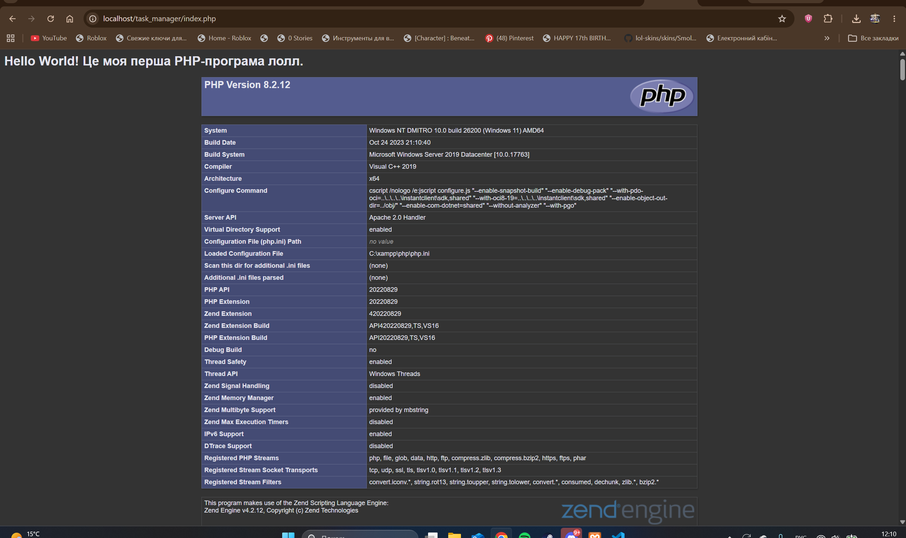

# Лабораторна робота №1

**Тема:** Встановлення сервера та “Hello World”.  
**Мета:** Набути практичних навичок зі встановлення та налаштування локального вебсервера, ознайомитися з базовим синтаксисом PHP та запустити перший файл.

## Фрагмент коду index.php

```php
<?php
  echo "<h1>Hello World! Це моя перша PHP-програма.</h1>";
  phpinfo();
?>

Відповіді на контрольні запитання
1. Яке призначення вебсервера (наприклад, Apache) у процесі веброзробки?
Вебсервер (Apache) приймає HTTP-запити від браузера користувача, обробляє їх і повертає відповідь. Коли запит стосується PHP-файлу, сервер передає цей файл інтерпретатору PHP на виконання. PHP виконує код і повертає серверу вже готовий HTML, який сервер відправляє браузеру. Без вебсервера PHP-код не виконується.
2. Яким розширенням файлу повинен володіти скрипт, щоб сервер обробив його як PHP-код?
Файл повинен мати розширення .php. Саме за цим розширенням Apache розуміє, що файл містить PHP-код і його потрібно передати інтерпретатору PHP, а не віддавати як звичайний статичний файл.
3. Чому PHP-файл потрібно відкривати через браузер за адресою localhost, а не просто подвійним кліком миші у файловому менеджері?
При подвійному кліку файл відкривається за протоколом file://. У цьому випадку вебсервер і PHP-інтерпретатор не запускаються, тому код PHP не виконується — браузер або показує вихідний код, або нічого. Через адресу http://localhost/... запит іде на локальний вебсервер Apache, який запускає PHP і повертає результат виконання.
4. За що відповідає конструкція echo у PHP?
Конструкція echo відповідає за виведення даних у потік виведення (у браузер). Вона використовується для виведення тексту, значень змінних, HTML-розмітки тощо. На відміну від функції, echo не повертає значення і може використовуватися як без дужок, так і з ними.
5. Яку інформацію виводить функція phpinfo() і для чого вона може знадобитись?
Функція phpinfo() виводить детальну інформацію про поточну конфігурацію PHP: версію PHP, налаштування з файлу php.ini, список завантажених модулів і розширень, змінні оточення, інформацію про сервер тощо. Вона корисна для діагностики середовища, перевірки правильності встановлення та налаштування PHP, а також для перегляду доступних можливостей.
