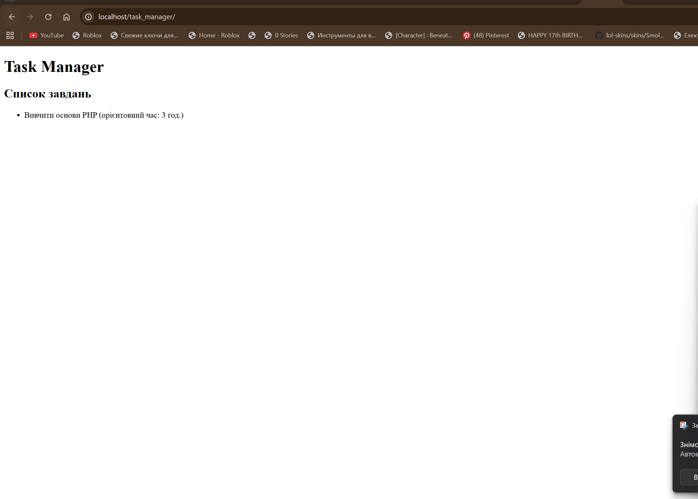

# Лабораторна робота №2

**Тема:** Виведення динамічного контенту.  
**Мета:** Закріпити навички комбінування HTML-розмітки з PHP-кодом, навчитись оголошувати змінні різного типу та динамічно виводити їх на сторінку.

## Фрагмент коду

```php
<?php
$appName = "Task Manager";
$taskTitle = "Вивчити основи PHP";
$taskTimeEstimate = 3;
?>
<!DOCTYPE html>
<html lang="uk">
<head>
    <meta charset="UTF-8">
    <title><?= $appName ?></title>
</head>
<body>
    <header>
        <h1><?= $appName ?></h1>
    </header>
    <main>
        <ul>
            <li><?= $taskTitle ?> (орієнтовний час: <?= $taskTimeEstimate ?> год.)</li>
        </ul>
    </main>
</body>
</html>

Відповіді на контрольні запитання
1. Що таке динамічна типізація і як вона працює в PHP?
Динамічна типізація означає, що тип змінної визначається автоматично під час виконання програми на основі присвоєного значення. У PHP не потрібно заздалегідь оголошувати тип змінної — якщо присвоїти рядок, змінна стане рядком, якщо число — числом. Тип може змінюватися протягом роботи скрипта.
2. Як правильно розпочати і закрити блок з PHP-кодом всередині HTML-документа?
PHP-блок починається з <?php і закінчується ?>. Його можна розміщувати в будь-якому місці HTML-документа. Для короткого виведення використовується альтернативний синтаксис <?= ... ?>.
3. В чому різниця між записами <?php echo $var; ?> та <?= $var ?>?
<?php echo $var; ?> — повний синтаксис виведення.

<?= $var ?> — короткий (альтернативний) синтаксис, який є еквівалентом <?php echo $var; ?>. Короткий варіант зручніший і частіше використовується при вбудовуванні значень у HTML.
4. Які основні (скалярні) типи даних підтримує PHP? Наведіть приклади.
Основні скалярні типи:

string — рядки ("Hello")
int — цілі числа (42)
float — числа з плаваючою точкою (3.14)
bool — логічні значення (true, false)

5. Що буде виведено в браузері, якщо користувач відкриє файл .html, всередині якого буде вбудовано <?php echo "Test"; ?> без налаштувань сервера? Поясніть чому.
Буде виведено вихідний код <?php echo "Test"; ?> або нічого (залежно від браузера). PHP-код не виконається, бо файл має розширення .html, а не .php, і сервер не передає його інтерпретатору PHP. Браузер просто показує вміст файлу як звичайний текст/HTML.
